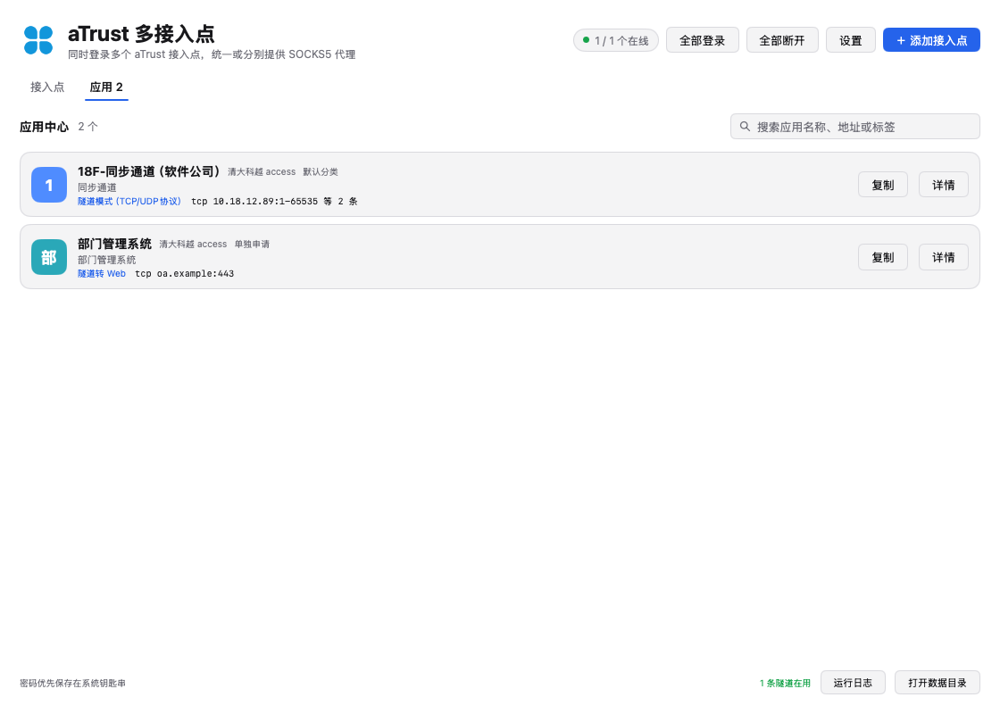
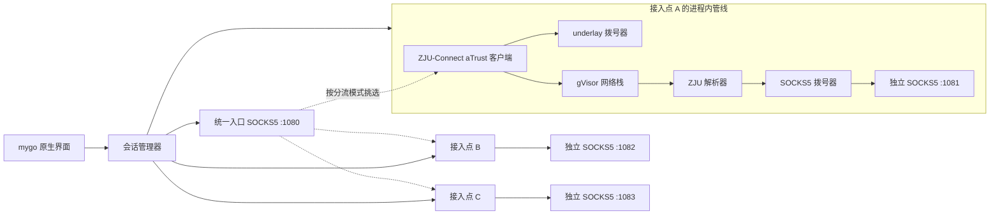

# aTrust Hub

用 [mygo](https://github.com/egoist/mygo) 写的桌面客户端，基于
[ZJU-Connect](https://github.com/Mythologyli/zju-connect) 的 aTrust 协议实现，
**同时登录多个 aTrust 接入点**，并为每个接入点以及所有接入点合起来提供
SOCKS5 代理。


窗口左上角和 macOS Dock/Finder 使用 `resources/icon.png`；源 SVG 是
`resources/icon.svg`。

## 它解决什么

一个 aTrust 账号通常只对应一个网关，但同一条内网往往有多个接入点：主网关、
教育网线路、备用网关，或者不同租户/区域的 aTrust 服务器。手工切换客户端既慢，
又会在切换时断开已有连接。

aTrust Hub 把「一个接入点」当成一条独立会话：

- 每个接入点有自己的 aTrust 登录、SID、设备 ID、客户端数据文件和会话；
- 所有接入点可以同时在线，互不影响；
- 每个接入点可以单独开一个本地 SOCKS5 端口；
- 另有一个**统一入口** SOCKS5，把新连接按延迟、轮询、故障转移或域名哈希
  分配到在线接入点；
- 某个接入点拨号失败时，统一入口会自动换下一个；
- 连接断开、健康检查连续失败或会话被服务器踢下线时，可自动重新登录。

> 这里的「多接入点」是**多个 aTrust 服务器/网关的同时登录**。
> 如果你指的是同一台 aTrust 服务器内部的多个节点组（node group），
> ZJU-Connect 在单个会话里已经会自动为每个节点组挑选最快的节点，
> 本应用会把它们显示在卡片底部。

## 功能

| 功能 | 说明 |
| --- | --- |
| 多接入点同时登录 | 每个接入点一个独立的 ZJU-Connect aTrust 客户端、gVisor 网络栈和 DNS 解析器 |
| 自动识别认证 | 登录时查询 authConfig：有密码且支持 `auth/psw` 就用密码，否则选企业微信/外部登录 |
| 企业微信 / 单点登录 | aTrust 的 `auth/qywechat` / `auth/httpsOauth2` / `auth/cas` 外部登录：弹出登录窗口，扫码后自动捕获回调 |
| 独立代理 | 每个接入点一个 SOCKS5 端口，适合把某个工具固定到某条线路 |
| 统一入口 | 一个 SOCKS5 端口，按分流模式在多条在线隧道之间分配连接 |
| 分流模式 | 延迟优先 / 轮询 / 故障转移 / 按域名固定 |
| 应用中心 | 登录后显示服务器下发的应用，按接入点/分类展示，支持搜索、详情、复制地址 |
| 自动重连 | 会话被断开时自动重新登录；可关闭 |
| 健康检查 | 通过 VPN 自己的 DNS 解析公网域名，既探活也保活；间隔可设为 0 关闭 |
| 凭据保护 | 密码和 TOTP 密钥保存在系统钥匙串；没有钥匙串时落到仅本用户可读的文件 |
| 设备 ID 复用 | 每个接入点单独保存 aTrust 客户端数据，重启后设备 ID 不变 |
| 原生界面 | mygo 自绘 UI，不依赖 WebView、前端构建或 Node.js |

## 快速开始

要求：Go **1.27.3** 或更新，macOS / Linux / Windows 桌面环境。

```sh
git clone <this repo> atrust-hub
cd atrust-hub
make run          # 或 go run .
```

首次运行：

1. 点右上角 **＋ 添加接入点**；
2. 填 **接入地址**，可以直接粘贴完整地址，例如
   `https://vpn.example.com:44892`；不写端口时默认 443，路径会被忽略；
3. **认证方式** 默认是 **自动识别**，也可以手动指定：
   - **自动识别**：登录时向服务器查询可用方式；有保存的密码且服务器支持
     `auth/psw` 就用密码，否则用企业微信 / 单点登录；
   - **账号密码**：填用户名、密码；需要动态口令时填 TOTP 密钥；
   - **企业微信 / 单点登录**：不需要账号密码，登录时会弹出扫码或 IdP 登录窗口；
   编辑器里的 **检测** 按钮会查询并列出服务器实际支持的认证方式。
4. 保存后点该卡片的 **登录**，或点顶部的 **全部登录**；
5. 客户端连 `socks5://127.0.0.1:1080`（统一入口），或卡片上显示的独立端口。

数据默认保存在：

- macOS：`~/Library/Application Support/aTrustHub/`
- Linux：`~/.config/aTrustHub/`
- Windows：`%AppData%\aTrustHub\`

可以用 `EASYCONNECT_HOME=/path/to/dir` 覆盖。

## 使用说明

### 接入点字段

- **接入地址**：aTrust 网关地址，例如 `https://vpn.example.com:44892`。
  可以直接粘贴带 `https://` 和端口的地址；不写端口时默认 443，路径会被忽略。
  编辑器写的是完整地址，`config.json` 里仍拆成 `server` 和 `port` 保存。
- **认证方式**：`自动识别`（默认）、`账号密码`（`auth/psw`）或
  `企业微信 / 单点登录`（外部登录）。
- **用户名 / 密码**：仅账号密码方式需要。
- **登录域**：账号密码方式默认 `Radius`（ZJU-Connect 的 aTrust 默认值）；
  企业微信方式可以留空，服务器有多个外部登录方式时用来区分。有些服务器用
  `Default`、`Local` 等，按管理员给的填；登录失败时先确认这里。
- **TOTP 密钥**：Base32 密钥，填了就会在登录时计算动态口令。
- **独立 SOCKS5 端口**：默认从 1081 开始分配。填 `0` 表示不单独开代理，
  只参与统一入口分流。
- **加入统一入口分流**：不勾选时，这个接入点只能通过自己的独立端口使用。
- **应用启动时自动登录**：启动后自动登录，不需要再点一次。

### 统一入口

统一入口监听 `127.0.0.1:1080`（可在 **设置** 里改）。它是普通 SOCKS5，
没有认证，默认只绑定回环地址。

分流模式：

- **延迟优先**：优先选最近拨号最快且在线的接入点；适合日常。
- **轮询**：新连接依次分配，适合多线路叠加带宽。
- **故障转移**：按列表顺序用第一个在线接入点，失败才换下一个；适合主备。
- **按域名固定**：按目标主机名哈希固定到一条线路，同一个站点尽量走同一条
  隧道；该线路拨号失败时仍会尝试下一条。

### 自动识别

新接入点默认使用自动识别，登录时先调用 aTrust 的

`GET /passport/v1/public/authConfig`

查询 `authServerInfoList`，然后：

1. 有保存的密码，且服务器提供 `auth/psw`：用账号密码登录；
2. 没有密码，或服务器不提供 `auth/psw`：优先 `auth/qywechat`，其次
   `auth/httpsOauth2` / `auth/cas`，弹出对应的扫码或 IdP 页面；
3. 服务器只有 `auth/psw` 又没有保存密码：报错并提示填密码或改用扫码。

编辑器里的 **检测** 按钮只查询认证方式、不登录，方便在添加时就看清服务器
支持什么。自动识别每次登录会多一次 authConfig 请求，这是查询方式必需的。

### 企业微信 / 单点登录

服务器支持 aTrust 的外部登录（`auth/qywechat`、`auth/httpsOauth2` 或
`auth/cas`）时，把认证方式选成 **企业微信 / 单点登录**：

1. 点 **登录**，应用先向服务器查询可用登录方式，再弹出一个独立的登录窗口；
2. 企业微信认证的二维码**显示在主窗口里**（不弹新窗口、不嵌 WebView），其他 IdP 仍用登录窗口；
3. 用企业微信扫码并在手机上确认；
4. 页面跳转到 `/passport/v1/auth/httpsOauth2`（或 `/auth/cas`）时，应用在
   请求发出**之前**截住回调地址，关闭窗口，把回调交给 ZJU-Connect 完成登录；
5. 登录成功后卡片显示在线，和密码方式一样参与统一入口分流。

应用优先选择 `authName` 里带「企业微信 / WeCom / WeWork」的外部登录方式；
如果服务器有多个外部方式，可以用「登录域」区分。

`auth/qywechat` 是 aTrust 自己的企业微信二维码接口（不是标准 OAuth2）。
ZJU-Connect 上游只支持 `auth/psw`、`auth/cas`、`auth/httpsOauth2`，所以本仓库
内置了一份打补丁的 ZJU-Connect（`third_party/zju-connect`），在**同一个登录
会话**里根据 AuthConfig 生成企业微信二维码 URL，扫码后把 WeCom 回调换回
portal ticket。补丁说明见 `third_party/zju-connect/PATCH.md`。

企业微信二维码直接画在主窗口的二维码卡片里：二维码图片和扫码状态都由应用向企业微信
请求，不打开第二个窗口、也不嵌 WebView，所以登录过程中主窗口仍可点击、滚动日志，
随时可以点卡片上的「取消登录」。CAS/OAuth2 等 IdP 仍用系统 WebView。

### 健康检查与重连

每 60 秒（可改）通过 VPN 的远程 DNS 解析 `www.baidu.com`，和
ZJU-Connect 自带的 keep-alive 一样。这样既能发现隧道已经不能承载流量，
也能让 aTrust 会话保持活跃。

连续 3 次失败且开启了自动重连时，会重新登录该接入点。如果你的 VPN DNS
不允许解析公网域名，请把 **健康检查间隔** 设为 `0`，否则会产生误判。

### 凭据保存在哪里

配置文件 `config.json` **不含密码**。密码和 TOTP 存在：

1. 系统钥匙串（macOS Keychain / Linux Secret Service / Windows Credential
   Manager）；
2. 钥匙串不可用时，`secrets.json`，权限 `0600`。

macOS 第一次读取时可能会弹出钥匙串授权框，允许即可。

## 应用中心

登录成功后，aTrust 下发的应用列表（`clientResource` 里的 `appList`）会显示在
**应用** 标签页：



- 每个应用显示名称、描述、分类、所属节点组、类型和服务器地址；
- 类型按 `accessModel` 和地址协议显示为「隧道模式（TCP/UDP协议）」「隧道转 Web」
  或「Web 模式」；
- 可以按名称、地址、分类或接入点名搜索；
- 点 **详情** 查看完整地址、节点组和浏览器打开地址；
- **复制** 复制该应用的所有后端地址。

应用只是服务器发布的资源；实际流量仍走所属接入点的隧道和现有分流规则。

### 密码存储方式

设置里有 **密码存储方式**：「本地文件（推荐）」把密码写到数据目录 `secrets.json`（0600）；
「系统钥匙串」用 macOS 钥匙串。应用是临时签名、重建后签名会变，钥匙串可能每次重新请求授权
（取消会报 -128），所以默认用本地文件。更改后需重启应用生效。

### 全局 TUN 模式

接入点在线后，主窗口顶部有 **全局 TUN** 开关。它为**每个在线接入点各启动一套
原生 ZJU-Connect TUN 栈**（随包附带 `zju-connect-multitun`），并复用已保存的
登录会话（cookie + resource 数据），不需要重新扫码。

- 每个接入点一个 `utun`，路由只覆盖该点自己的 IP 资源，互不冲突；
- 内网域名由各点的伪装 IP 池（`198.18.0.0/17`、`198.18.128.0/17`…）分配地址，
  数据包进 TUN 后由 `ipPool` 反查回域名再走隧道，所以 HTTPS 证书正常；
- 系统 DNS 指向 helper 自己的解析器（`127.0.0.1:53`），它按点询问各点 resolver，
  非内网域名转发上游；helper 会持续守护这个设置；
- **首次开启需要一次管理员授权**，用来安装一条 sudoers 免密规则
  （`/etc/sudoers.d/atrust-hub`，只允许运行这个 helper），之后开启不再弹密码；
- 关闭开关或退出应用时，helper 会退出并**自动把系统 DNS 还原**，不会断网。

应急恢复（若网络异常）：

```sh
sudo pkill -f zju-connect-multitun
for s in "Wi-Fi" "USB 10/100/1000 LAN" "Thunderbolt Bridge"; do
  sudo networksetup -setdnsservers "$s" Empty
  sudo networksetup -setwebproxystate "$s" off
  sudo networksetup -setsocksfirewallproxystate "$s" off
done
```

### 一键系统代理（登录后不用手配浏览器）

接入点在线、统一入口启动后，主窗口顶部出现 **设为系统代理** 按钮：点一次，
macOS 会把所有已启用的网络服务的 SOCKS / HTTP / HTTPS 代理指向本应用统一入口
（会弹出一次管理员授权）。浏览器随后直接访问隧道应用即可，不需要再配
Zero Omega。再点一次或退出应用会取消。

### 访问隧道应用（例如 app.example.com）

「隧道模式」应用只提供了隧道，本应用把它暴露为 **SOCKS5 代理**，不会改系统路由，
所以**浏览器默认不会走隧道**，直接打开 `https://app.example.com/...` 会失败
（该域名在公网 DNS 里通常也解析不到）。

正确做法：

1. 让接入点保持「在线」；
2. 把浏览器或系统的**代理**设为统一入口 `127.0.0.1:<统一入口端口>`
   （或该接入点的独立端口，如 `127.0.0.1:1081`）；**协议优先选 HTTP**，
   其次 SOCKS5。同一个端口两种协议都支持：`CONNECT` 里带域名，由隧道解析；
3. 打开代理的 **远程 DNS / 代理解析域名**（Chrome/Edge 用 SOCKS5 时代理会解析域名；
   Safari 用系统代理要在系统设置里填 SOCKS5）；
4. 再访问应用地址。

在应用详情里点 **用代理浏览器打开**，会用一个临时配置的 Chrome/Edge 直接
走该代理打开应用，不需要动系统或扩展的代理设置。

在应用详情里点 **测试连通性**，会通过隧道直连后端地址：显示「可达」说明隧道没问题，
浏览器仍打不开就是浏览器没走代理；显示「无法连接」才是隧道/权限问题。
如果是 Web 应用，详情里的「打开」会用系统浏览器打开 `accessEntry`。

应用卡片用名称首字做图标；服务器返回的 `iconPath` 需要登录态才能取，所以暂不
加载远程图标。想在排查字段时保留原始 `clientResource`：

```sh
EASYCONNECT_DUMP_RESOURCE=1 \
EASYCONNECT_HOME="$PWD/testdata/four-points" \
  ./build/darwin-arm64/aTrustHub.app/Contents/MacOS/aTrustHub
```

登录后原始 JSON 会写到 `<数据目录>/atrust/<接入点 id>.resource.json`（0600）。

## 架构



每个接入点调用一次 `atrustclient.NewClient(...).Setup(...)`，然后创建自己的
`gvisor.NewStack`、`resolve.NewResolver`、`dial.NewDialer`。这些对象都只属于
该接入点，所以多个会话可以在一个进程里并行工作。

统一入口的 `Dial` 会先挑选一个在线会话，再调用它的拨号器；失败时把该接入点
加入本次排除列表并换下一个（最多 3 个）。

关键代码：

- `internal/vpn/zju.go` — ZJU-Connect aTrust 登录、网络栈、DNS、探活；
- `internal/vpn/zju_login.go` — 查询服务器登录方式、企业微信/外部登录回调；
- `third_party/zju-connect` — 打过 `auth/qywechat` 补丁的 ZJU-Connect；
- `internal/vpn/manager.go` — 多会话生命周期、分流、重连、统计；
- `login.go` — 弹出扫码窗口并在请求发出前截住回调地址；
- `internal/proxy/socks5.go` — 自己的 SOCKS5 服务端（CONNECT）；
- `internal/store` — 配置、钥匙串/文件凭据；
- `app.go` / `view.go` — mygo 原生界面。

## 构建与测试

```sh
make test         # 单元测试，不需要窗口和真实 VPN
make vet
make build        # 打成 .app / 可执行文件
make dmg          # macOS 磁盘映像
```

只能写当前目录的环境（沙箱、临时机）加 `LOCAL=1`，模块和编译缓存会落到
`.cache/`：

```sh
make LOCAL=1 test
make LOCAL=1 build
```

只构建一个裸二进制：

```sh
go build -o aTrustHub .
```

依赖版本固定在 `go.mod` / `go.sum`：

- `github.com/mythologyli/zju-connect v1.3.1`，通过 `replace` 指向
  `third_party/zju-connect`，加了 `auth/qywechat` 和应用列表的支持；
- `github.com/egoist/mygo v0.7.3`。

选 v1.3.1 而不是 `main`：这个版本没有在会话刷新失败时直接
`log.Fatalf` 的逻辑，更适合被一个长期运行的 GUI 进程内嵌。代价是没有
ZJU-Connect 新版的自动会话刷新，本应用用健康检查和重新登录补上。

## 配置格式

`config.json` 示例（密码不在这里）：

```json
{
  "version": 1,
  "settings": {
    "listenHost": "127.0.0.1",
    "aggregatePort": 1080,
    "aggregateEnabled": true,
    "routing": "latency",
    "healthIntervalSec": 60,
    "autoReconnect": true
  },
  "points": [
    {
      "id": "0f3a9c1b2d4e",
      "name": "主网关",
      "server": "atrust.example.edu.cn",
      "port": 443,
      "username": "alice",
      "authMode": "auto",
      "loginDomain": "",
      "socksPort": 1081,
      "inPool": true,
      "autoConnect": true
    }
  ]
}
```

aTrust 客户端数据（设备 ID、Cookie）在
`<数据目录>/atrust/<id>.json`，权限 `0600`。

## 限制

- **SOCKS5 只支持 TCP CONNECT**。UDP ASSOCIATE 会返回「命令不支持」。
  浏览网页、SSH、Git、数据库等 TCP 场景不受影响。
- **外部登录支持 `auth/qywechat`、`auth/httpsOauth2` 和 `auth/cas`**。
  服务器只提供密码、短信或图形验证码时，请用账号密码方式；图形验证码目前
  不支持。
- **CAS/OAuth2 登录窗口依赖内嵌 WebView**。企业 IdP 禁止内嵌浏览器时可能打不开；
  企业微信二维码已改为主窗口内卡片。
- **单进程**。所有隧道都在同一个进程里；进程退出会断开全部接入点。
  ZJU-Connect 的 L3 写失败路径会产生 panic，代码在拨号和网络栈入口做了
  兜底，但不能保证第三方库在所有 goroutine 里都不崩溃。
- **服务器可能不允许同一账号多会话**。如果 aTrust 策略是后登录踢掉先登录，
  多接入点同时在线会被服务器拒绝；这不是客户端能绕过的。
- **扫码登录一次只开一个窗口**。多个扫码接入点同时登录时，后一个会等前一个
  完成，避免窗口堆叠。
- **系统代理与 TUN 都可选**。默认只提供 SOCKS5 本地端口；勾选系统代理或全局 TUN
  后才会修改系统设置，关闭时会还原。
- 统一入口默认无认证。改成 `0.0.0.0` 前请确认所在网络可信。

## 扫码后没有反应

企业微信二维码页显示“扫描成功”只代表手机扫到了码，**还要在手机的企业微信里
点“确认登录”**；桌面窗口会停在“请在企业微信中点击确认即可登录”，这是正常的
等待状态。主窗口的二维码卡片会显示“已扫码，请在手机企业微信中点击确认”。

应用直接从企业微信轮询扫码状态：手机确认后拿到 `auth_code` 并继续登录，
不需要二维码页自己跳转。

如果手机已经确认、窗口仍然不关，看 **运行日志** 里这几行：

- `扫码状态：QRCODE_SCAN_ING`：已扫码，等待手机确认；
- `扫码状态：QRCODE_SCAN_SUCC` / `手机已确认，收到扫码回调`：应用已经拿到回调；
- `登录页跳转 .../passport/v1/auth/qywechat`：浏览器也拿到了回调；
- `登录页地址 .../passport/v1/auth/qywechat`：轮询也看到了回调；
- `Perform GET /passport/v1/auth/qywechat`：应用正在用登录会话换 ticket。

没有第一行，说明页面还没跳回调（通常是手机没确认，或二维码过期）；有第一行
但没有第三行，把日志发我。日志只记录路径，不记录 `code` / `state`。
有些企业微信返回的是 `auth_code` 而不是 `code`，已经兼容。

## 实测记录

四个 aTrust 接入点的连通性和登录方式测试见
[docs/access-points.md](docs/access-points.md)。仓库里带了一份不含凭据的
四点配置：`testdata/four-points/config.json`，可以用
`EASYCONNECT_HOME="$PWD/testdata/four-points" ...` 启动。

## 致谢

- [ZJU-Connect](https://github.com/Mythologyli/zju-connect)：aTrust /
  EasyConnect 协议的 Go 实现。
- [mygo](https://github.com/egoist/mygo)：纯 Go 的桌面应用框架。

本项目以 **AGPL-3.0** 发布，因为链接了 AGPL-3.0 的 ZJU-Connect。
