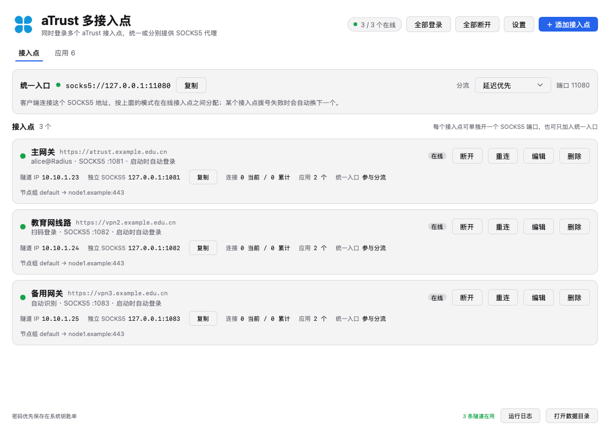

# aTrust Hub

[](https://github.com/weigram/aTrustHub/actions/workflows/build.yml)
[](https://github.com/weigram/aTrustHub/releases)

**同时登录多个 aTrust 接入点**的桌面客户端（macOS / Windows）。一个窗口里管理多个
零信任网关，每个接入点各自保持一条独立隧道，并能按「目标属于谁」自动分流。

支持三种登录方式：**企业微信认证**（扫码 / 电脑端确认）、**账号密码**（可叠加 TOTP）
与**第三方单点登录**（浏览器完成，含短信 / IDaaS / CAS）。



## 它解决什么

官方 aTrust 客户端一次只能连一个网关，而现实中经常要同时用多个：

- 公司 A 的网关（办公网、GitLab、内部系统）；
- 公司 B / 分公司 / 客户的网关（另一套内网、另一批应用）。

来回断开重连很麻烦，而且很多工具（MySQL 客户端、SSH、Git）不会走浏览器代理。
aTrust Hub 的做法是：

1. 每个接入点各建一条隧道，互不影响；
2. 每个接入点开一个本地 SOCKS5 端口；
3. 再提供一个**统一入口** SOCKS5，按策略把连接交给合适的接入点；
4. 需要「不用配代理就能访问」时，打开**全局 TUN**，按接入点分别注入路由。

> 这里的「多接入点」指**多个 aTrust 服务器/网关的同时登录**。

## 功能

| 能力 | 说明 |
| --- | --- |
| 多接入点同时在线 | 每个点独立隧道、独立 SOCKS5 端口、独立状态 |
| 企业微信认证 | 选「企业微信」后弹窗显示二维码，支持手机扫码与电脑端确认，也可用本地微信认证 |
| 账号密码登录 | 选「账号密码」后自动登录，可选登录域、可选 TOTP 动态口令 |
| 第三方单点登录 | 选「第三方单点登录」（`auth/cas` 等）后点「登录」会用浏览器完成，再自动取回会话 |
| 统一入口分流 | 故障转移 / 延迟优先 / 轮询 / 哈希，且**优先选覆盖目标资源的接入点** |
| 应用中心 | 按接入点分块、可折叠，展示每个应用地址并测试可达性 |
| 访问日志 | 记录「目标 + 端口 → 接入点 + 应用」，成功绿点、失败红点 |
| 全局 TUN | 每个接入点一套原生 TUN 栈，内网域名与证书正常，无需配代理 |
| 系统代理 | 一键把系统代理指向统一入口（macOS / Windows），带监听检查与自动回收 |
| 会话复用 | 保存登录会话，开 TUN 时不需要重新扫码 |
| 隧道保活自愈 | 全局 TUN 下每 90 秒用真实内网地址探一次；连续 2 次不通就自动重登该点，不用手动重启 TUN |
| 退出清理保证 | 退出前停 TUN、还原系统 DNS、关闭系统代理并删除控制文件；即使 helper 被强杀也会兜底重置 DNS |
| 按应用停用代理 | 应用中心每个应用一个开关，关掉后它的 IP 段与域名不进隧道，用于解决与本地或其它接入点的网段冲突 |
| 会话有效性监测 | 定期向网关确认本次登录是否仍是有效会话；被其它客户端顶掉时立即说明原因并断开该接入点 |
| 浏览器登录窗口 | Chrome / Edge 独立配置目录，隐藏「恢复页面」与不受支持标记的提示条，退出时正常关闭 |

## 快速开始

1. 打开应用，点右上角 **+ 添加接入点**；
2. 填名称与**接入地址**（如 `https://vpn.example.com:443`，不写端口默认 443）；
3. 在**认证方式**里选一种（账号密码 / 企业微信 / 第三方单点登录），可点 **检测**
   先确认该网关支持哪些方式；
4. 保存后点卡片上的 **登录**，登录流程按认证方式自动执行：
   - 企业微信：弹窗里扫码，或在手机企业微信里点确认；
   - 账号密码：用填好的用户名 / 密码（可选 TOTP）自动登录；
   - 第三方单点登录：打开浏览器完成单点登录，成功后自动取回会话并连接。
5. 多个接入点都登录后，客户端连统一入口 `socks5://127.0.0.1:10880` 即可。

> 默认**不会**自动登录。需要随应用启动就连接的点，在编辑弹窗里勾选
> 「应用启动时自动登录」。

## 登录方式

### 企业微信认证

认证方式选 **企业微信**（网关通常为 `auth/qywechat` 或 `auth/httpsOauth2`）时，
点「登录」会弹出应用内的二维码窗口：

- **手机扫码**：用企业微信扫一扫并确认；
- **电脑端确认**：已在电脑登录企业微信时，手机端会收到确认提示；
- **本地微信认证**：二维码下方按钮，用本机已登录的企业微信完成认证；
  若这台机器上本地桥不向本程序开放（Windows 客户端只服务浏览器），点一次失败后会
  **自动改用浏览器**完成，不需要再点第二个按钮。

> 企业微信只需要借浏览器走一次网页授权，所以它使用**一次性浏览器配置目录**，
> 登录结束（成功或失败）立即删除，不会在数据目录里留下 cookie。

点「退出登录」对不同的接入点做的事不同：

| 认证方式 | 清除内容 | 提示词 |
| --- | --- | --- |
| 企业微信 | 只清本地暂存的认证信息 | 「会清除本地暂存的认证信息，下次登录需要重新认证。」 |
| 第三方单点登录 | 认证信息 + 浏览器登录数据（cookie / localStorage / IdP 会话） | 「会清除本地暂存的认证信息与浏览器登录数据（cookie），下次登录需要重新认证。」 |

登录成功后会话保存在数据目录，后续开启全局 TUN 不需要再扫码。

### 账号密码

认证方式选 **账号密码** 后填 **用户名 + 密码**，点「登录」即自动登录，另有两个可选字段：

- **登录域**：RADIUS / 域认证需要时填写；
- **TOTP 密钥**：填 Base32 密钥即自动生成动态口令。

密码存放位置可选「本地文件（推荐，`0600`）」或「系统钥匙串」。

### 第三方单点登录

认证方式选 **第三方单点登录**（`auth/cas` 等需要网页交互的网关）后，
点「登录」会用 Chrome / Edge 打开登录页，在浏览器里完成单点登录（含短信、扫码、IDaaS），
登录成功后自动取回会话并建立隧道。

> 早期版本里的「自动识别」已从认证方式中移除：现在登录流程完全按这里选的认证方式执行，
> 卡片上只剩一个「登录」按钮。老配置里的 `auto` 仍能登录，编辑该接入点时会被转成上面三种之一。

## 统一入口

统一入口是本地 SOCKS5，默认 `127.0.0.1:10880`，分流策略在界面上切换：

| 模式 | 行为 |
| --- | --- |
| 故障转移 | 固定用第一个可用接入点，失败后换下一个 |
| 延迟优先 | 选当前延迟最低的接入点 |
| 轮询 | 按连接轮流分配 |
| 哈希 | 同一目标固定走同一接入点 |

此外还有一层**资源优先**：若某接入点发布了覆盖目标主机/域名的应用
（IP、`A-B` 网段、CIDR 或域名），优先走那个接入点，避免「能连上但打不开」。

### 系统代理

右上角的「系统代理」开关会把系统 SOCKS / HTTP / HTTPS 代理指向统一入口，适合
浏览器等遵从这个设置的程序。为避免把整台机器指到一个没人监听的端口：

- **只有统一入口正在监听时才允许打开**（打开前会先探测端口）；
- **全局 TUN 开启时开关是禁用的**——那时应用侧代理已经停止，流量走系统路由；
- 运行中若统一入口停止监听（例如所有接入点掉线、或开了 TUN），**自动关闭系统代理**；
- **退出应用时一定会关闭系统代理**，失败会重试并写日志。

统一入口卡片只在系统代理开启时显示；地址与端口随时可在「设置」里查看。

## 应用中心

登录后自动拉取该接入点的应用列表，按接入点分块展示，可折叠。每个应用可以：

- 查看服务器地址（域名 / IP / 端口）；
- **复制地址**、**复制代理**；
- **测试全部地址**：经统一入口逐个探测，显示延迟或失败原因；
- **用代理浏览器打开**：自动带上代理打开该地址。

## 访问日志

「访问日志」标签记录每次经隧道访问的目标：

```
19:41:17  ● db.internal.example:3306 → 办公网关 ｜ 应用：内部数据库
19:42:36  ● gitlab.example.com:443 → 办公网关 ｜ 应用：GitLab
19:43:02  ● 10.0.0.9:443 ｜ 研发网关 ｜ tcp tunnel connection not allowed
```

- 绿点成功、红点失败；失败会写明原因（拒绝、超时、无资源等）；
- 同一目标重复访问只保留一行，**只更新时间**，不会刷屏；
- 代理模式与 TUN 模式的访问都会记录。

## 全局 TUN

打开 **全局 TUN** 后，不需要给任何客户端配代理即可访问内网：

- 每个在线接入点各启动一套原生 ZJU-Connect TUN 栈（`zju-connect-multitun`），
  各自一个 `utun`，路由只覆盖该点自己的 IP 资源，互不冲突；
- 内网域名由各点的伪装 IP 池（`198.18.0.0/17`、`198.18.128.0/17`…）分配地址，
  数据包进 TUN 后反查回域名再走隧道，**HTTPS 证书正常**；
- 系统 DNS 指向 helper 自己的解析器，非内网域名转发上游，并持续守护该设置；
- **首次开启需要一次管理员授权**，用于安装一条 sudoers 免密规则
  （`/etc/sudoers.d/atrust-hub`，只允许运行这个 helper），之后开启不再弹密码；
- 关闭开关或退出应用时，helper 退出并**自动还原系统 DNS**，不会断网；
  退出时最多等 6 秒，超时会强制结束并**兜底把系统 DNS 重置为自动**；
- 开启 TUN 前会自动关闭系统代理（否则流量会被指向已停止的应用侧代理）；
- **隧道保活**：每 90 秒用一条真实内网地址做一次 TCP 探测，连续 2 次失败就重新登录
  该接入点（复用已保存会话，不弹二维码），会话文件刷新后 helper 自动重建隧道。

应急恢复（若网络异常）：

```sh
sudo pkill -f zju-connect-multitun
for s in "Wi-Fi" "USB 10/100/1000 LAN" "Thunderbolt Bridge"; do
  sudo networksetup -setdnsservers "$s" Empty
  sudo networksetup -setwebproxystate "$s" off
  sudo networksetup -setsocksfirewallproxystate "$s" off
done
```

## 会话有效性监测

同一个账号在别处登录时，aTrust 会顶掉旧会话。此时隧道看起来还在，实际已经不能通信，
只有问服务器才知道。接入点配置里可以按点开关这个监测并设置间隔：

| 项 | 默认 | 说明 |
| --- | --- | --- |
| 监测会话是否仍有效 | 开 | 关掉后不再向网关发检测请求 |
| 监测间隔（秒） | 300 | 下限 30 秒，避免过于频繁 |

工作方式：

- 到点向 `GET /passport/v1/user/onlineInfo` 发一次带本会话 Cookie 的请求；
- 返回正常则记为「有效」；网络问题只记「无法确认」，不影响隧道；
- 服务器判定会话不可用时计数，**连续两次**才断开该接入点，并在卡片上写明
  「会话已被其它客户端顶掉」及服务器返回的 code，避免偶发抖动误杀；
- 断开后不会自动重登录——那会把对方客户端顶掉，形成互相踢；需要时手动点「登录」。

接入点卡片会显示「会话监测：有效 · 每 300 秒 · 上次 10:41:02」，并有「立即检测」按钮。

## 隧道保活与自动重建

门户说「在线」不等于隧道还能转发：aTrust 会在空闲一段时间后回收会话，这时
`onlineInfo` 仍返回有效，卡片也还是「在线」，只有真正访问应用才会发现不通。
所以每个接入点还有一条**空闲业务保活**，它只关心隧道本身：

- 设置里的**健康检查间隔**（默认 60 秒）同时是「空闲多久才探测」的阈值；这期间
  有过成功连接的点不会被探测；
- 探测优先拨该接入点自己某个应用的 TCP 地址（真实业务路径），没有可用地址时
  退回「经隧道做一次 DNS 查询」；
- 失败只标记、不登录：卡片先显示「隧道保活探测失败（n/3）」，10 秒后复测；
- 连续 3 次失败判定为**隧道失效（登录仍有效）**，卡片标红并自动重建：
  - 代理模式：断开这条隧道，用已保存的会话重新登录（resume），不需要重新扫码；
  - 全局 TUN：先让 helper 退出、把接入点交还 GUI 重新登录，再用新会话重启 TUN；
- 连续重建 3 次仍失败就停下并提示手动处理，避免反复重启；
- TUN 模式的探测由 helper 用真实隧道完成（本地拨号在 TUN 栈里会直接握手成功，
  看不出问题）；只走 L3 的资源无法用连接探测，会跳过而不是误判。

## 数据目录

```
~/Library/Application Support/aTrust Hub/
├── config.json              # 接入点与设置
├── secrets.json             # 密码（0600，可选钥匙串）
├── app.log                  # 应用日志
├── browser/<id>/            # 单点登录用的浏览器配置（企业微信用完即删）
├── atrust/<id>.json         # 登录会话（TUN 复用）
├── atrust/<id>.resource.json
├── tun.log                  # TUN helper 日志
├── tun-access.log           # TUN 访问记录
└── tun-config.json          # TUN 启动参数
```

界面右下角 **打开数据目录** 可直接定位。

## 下载

到 [Releases](https://github.com/weigram/aTrustHub/releases) 下载对应平台的安装文件：

| 平台 | 文件 | 说明 |
| --- | --- | --- |
| macOS（通用） | `atrusthub-<版本>.dmg` | 一个包同时支持 Apple Silicon 与 Intel，打开后拖进「应用程序」 |
| Windows x64 | `atrusthub-setup-<版本>-amd64.exe` | 安装包，双击安装即可 |
| Windows 32 位 / ARM64 | — | 构建脚本已支持，当前版本暂不发布 |

macOS 首次打开若被 Gatekeeper 拦截，右键 →「打开」，或执行
`xattr -dr com.apple.quarantine /Applications/aTrustHub.app`。

Windows 版提供**代理模式**（多接入点、统一入口 SOCKS5、应用中心、访问日志）与
**系统代理开关**（写 WinINET 设置，浏览器等应用自动走代理）；
全局 TUN 依赖 wintun，启动时会请求管理员权限，仍在验证中。

## 构建

需要 Go 1.27+ 与 macOS（Apple Silicon 或 Intel）。

```sh
make helpers   # 编译 TUN 辅助程序到 resources/
make build     # 打包 .app（产物在 build/darwin-arm64/）
make test      # 单元测试
```

`make helpers` 编译 `third_party/zju-connect/cmd/multitun`。这是打了补丁的
ZJU-Connect 分支（新增企业微信认证、应用列表、会话复用、多点 TUN 等），
编译产物不随仓库提交，需要本地生成。

## 持续集成

`.github/workflows/build.yml` 会在每次 push / PR 时跑测试，打 `v*` 标签时打包并
创建 Release。当前发布的产物是 macOS（`.dmg`，通用架构）与 Windows x64
（NSIS 安装包 `.exe`）；Windows 32 位与 ARM64 的矩阵条目已在脚本中备好，
处于注释状态，取消注释即可产出对应安装包与同架构 helper。

```sh
git tag v1.0.0 && git push origin v1.0.0
```

## 架构

```
┌──────────── aTrust Hub（单个进程）────────────┐
│  接入点 A ─ gVisor 栈 ─ resolver ─ SOCKS5 :1081 │
│  接入点 B ─ gVisor 栈 ─ resolver ─ SOCKS5 :1083 │
│  接入点 C ─ gVisor 栈 ─ resolver ─ SOCKS5 :1082 │
│                 └── 统一入口 SOCKS5 :10880 ──┘ │
└───────────────────────────────────────────────┘
                    │ 需要免配代理时
                    ▼
      zju-connect-multitun（root）
      每个接入点一套原生 TUN 栈 + 独立伪装 IP 池
      系统 DNS 127.0.0.1 → 按接入点解析
```

## 平台差异

| 功能 | macOS | Windows |
| --- | --- | --- |
| 多接入点 + 统一入口 SOCKS5 | ✅ | ✅ |
| 企业微信 / 账号密码登录 | ✅ | ✅ |
| 应用中心、访问日志 | ✅ | ✅ |
| 全局 TUN | ✅ | 实验（需 UAC，wintun） |
| 系统代理开关 | ✅ | ✅（WinINET） |
| 第三方单点登录 | ✅ Chrome / Edge + CDP | ✅ Chrome / Edge + CDP |

## 限制

- **服务器可能不允许同一账号多会话**。若 aTrust 策略是「后登录踢掉先登录」，
  同一账号在两个接入点同时在线会被服务器拒绝，客户端无法绕过。
- **扫码登录一次只开一个窗口**：多个扫码接入点同时登录时，后一个会等前一个完成。
- **全局 TUN 需要管理员权限**（创建 utun、改路由与 DNS）。
- **企业微信认证依赖网关支持** `auth/qywechat`；不支持的网关请用账号密码或 CAS。
- **企业微信的浏览器回退需要 Chrome / Edge**：授权码只出现在浏览器跳转地址里，
  默认浏览器（如 Safari）没有调试端口，取不到那一次跳转；没有 Chrome / Edge 时
  请用手机扫码或先登录电脑版企业微信。
- 统一入口默认无认证，改成监听 `0.0.0.0` 前请确认所在网络可信。

## 常见问题

**扫码成功但应用没反应？**
手机显示「扫描成功」只代表扫到了码，还需在手机企业微信里点确认；
若仍无反应，看「运行日志」里是否有 `confirm` 或 `ticket` 相关错误。

**域名能解析但打不开？**
确认该域名在对应接入点的应用列表里。若走 TUN，确认全局 TUN 已开启，
且 `tun.log` 中该接入点显示 `ready`。

**开了 TUN 后外网变慢或不通？**
TUN 只接管各接入点的内网网段，外网仍走原路由。若异常，先关掉 TUN，
或按上面「应急恢复」清理 DNS。

**一直显示「处理中」？**
看数据目录 `tun.log` 末尾：常见原因是某个接入点会话过期，重新登录该点即可。

## 致谢

- [ZJU-Connect](https://github.com/mythologyli/zju-connect)：aTrust / EasyConnect 协议实现，
  本项目内置了打过补丁的分支；
- [mygo](https://github.com/egoist/mygo)：原生 macOS UI 框架。

## 许可

MIT
